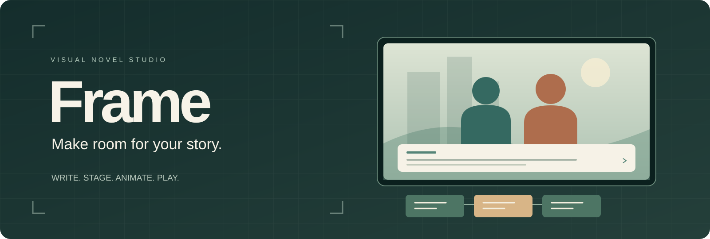
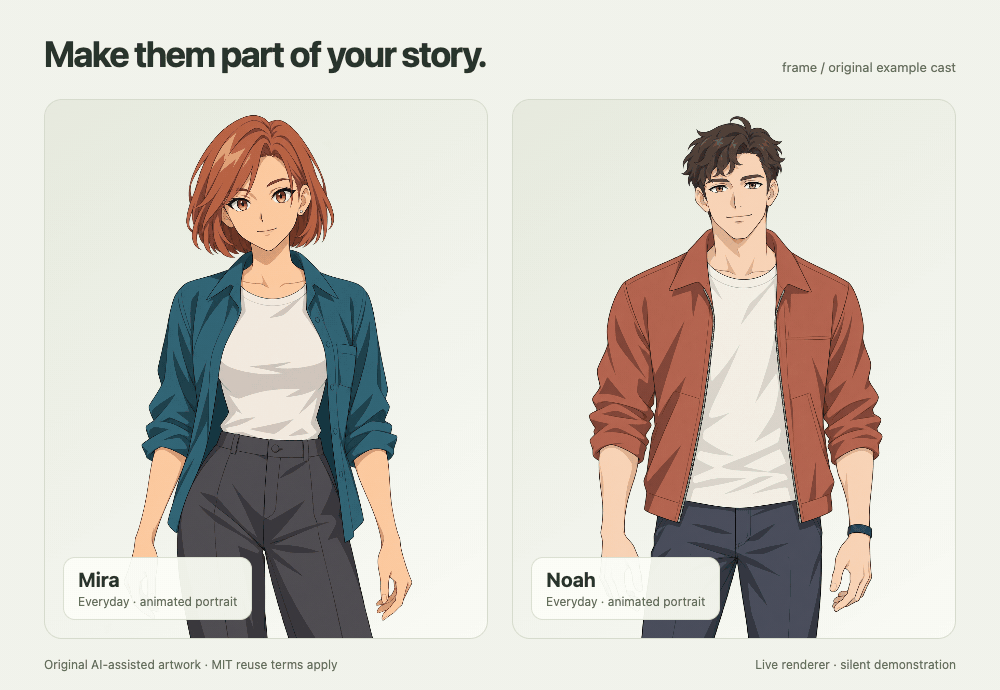

<p align="center"></p>

<p align="center"><strong>A local visual novel studio. An animated cast. A game you can take anywhere.</strong></p>
<p align="center"><a href="https://github.com/Marioarttv/frame-vn/actions/workflows/ci.yml"></a></p>
<p align="center"><a href="docs/getting-started.md">Start creating</a> · <a href="docs/README.md">Documentation</a> · <a href="CONTRIBUTING.md">Contribute</a> · <a href="LICENSE">MIT license</a></p>

Frame helps you write branching conversations, direct characters on a live stage, and export your story as a self-contained HTML game or an MP4. It runs on your computer. Writing, playing, and exporting games require no account or API key.


**v0.1.0 · Early release.** Includes two original animated examples, a branching starter story, a stage tour, and source artwork with reproducible rig recipes. See the [release notes](CHANGELOG.md) and [verification record](docs/release-plan.md).

[Download the playable example and rig playground](https://github.com/Marioarttv/frame-vn/releases/latest) to try the renderer without installing the studio.

## Make your first story

Install **Node.js 22.12 or newer**, then:

```sh
git clone https://github.com/Marioarttv/frame-vn.git
cd frame-vn
npm ci
npm run dev
```

Open **http://127.0.0.1:5178**. Play **First Light**, duplicate it in **Manage projects**, and make it yours. The [beginner walkthrough](docs/getting-started.md) takes you from your first line to an offline game. A [short studio recording](https://github.com/Marioarttv/frame-vn/releases/download/v0.1.0/studio-walkthrough.mp4) shows editing, playing, and exporting.

## What you can create

- **Branching stories:** dialogue, choices, variables, conditions, and a map of connected scenes.
- **A directed performance:** drag characters onto the live stage; choose expressions, gestures, transitions, camera moves, weather, and text presentation.
- **An animated cast:** calibrated mouth shapes and independent blinks, with restrained gaze, brow, head, and body motion. Static portraits work too.
- **Portable games:** a single HTML file containing the story, used media, and player. History, save/load, auto advance, keyboard controls, and reading settings travel with it.
- **Local video:** choose a route and render an MP4 with mixed voice, music, ambience, and effects.
- **Optional generated dialogue:** connect your own ElevenLabs account locally. Completed recordings are cached; uncertain outcomes are recorded and never automatically retried.

The studio preview and exported game use the same renderer. Facial articulation follows the recording's playback clock. New artwork needs authored feature layers and calibration; arbitrary PNGs do not automatically become complete animated rigs.



*The original example cast, rendered by Frame. Silent mouth-shape and blink demonstration; no generated speech is included. [Sources, rig reproduction, and rights](docs/example-characters.md).*

## Choose a workflow

| I want to… | Start here |
| --- | --- |
| Make my first playable story | [Beginner walkthrough](docs/getting-started.md) |
| Direct scenes and choices | Storyboard or Scene builder in the studio |
| Add an original animated character | [Character authoring](docs/character-authoring-api.md) |
| Configure speech and lip sync | [Voice setup](docs/voice-pipeline.md) |
| Render a trailer or linear chapter | [Video export](docs/video-export.md) |
| Build on the engine | [Architecture](docs/architecture.md) and [project format](docs/project-format.md) |
| Fix an installation or playback problem | [Troubleshooting](docs/troubleshooting.md) |

## Optional tools

The basic editor and offline game export need Node.js and a browser. Character compilation and browser tests also need Google Chrome or an explicitly installed Playwright Chromium (`npm run setup:browser`). MP4 rendering needs FFmpeg and FFprobe.

Generated speech additionally needs your own server-side provider key and a working [Rhubarb Lip Sync](https://github.com/DanielSWolf/rhubarb-lip-sync/releases) installation with its `res/` resources. Follow [voice setup](docs/voice-pipeline.md). Generation may incur charges on your provider account; automated tests use mock or injected transports.

## Your projects stay local

Projects autosave in the current browser's IndexedDB. **Export project JSON** creates an editable backup containing its images and recordings; **Export playable game** creates the game you share. Keep both. Browser storage alone is not a backup.

Private local packs, authoring state, and environment files are ignored by Git and excluded from the production studio build. A game export deliberately embeds its used media: check its permissions before sharing it.

The local authoring API binds to loopback and is intended for one user on their own machine. Do not expose it as a public multi-user service. See [Security](SECURITY.md).

## Develop Frame

```sh
npm ci
npm run setup:browser   # Explicit browser installation, if needed
npm test
npm run build
npm run test:e2e
```

The production build excludes private packs and carries the applicable license notices. Player bundles are generated from source with `npm run prebuild`; do not edit generated files by hand. Set `FRAME_PORT` when another local project uses port 5178.

See [Contributing](CONTRIBUTING.md) for verification expectations and [the documentation index](docs/README.md) for the source layout and workflows.

## License and media rights

Frame's original code, documentation, and original starter assets use the [MIT license](LICENSE). Third-party fonts, icons, and dependencies retain their own licenses; see [Third-party notices](THIRD_PARTY_NOTICES.md) and [the dependency license inventory](THIRD_PARTY_LICENSES.txt).

The original example portraits are AI-assisted designs with retained source and edit provenance. No franchise character artwork, private cast packs, or provider recordings are included. Imported stories, artwork, voices, and music remain subject to their own permissions. Frame's code license does not grant rights to those materials.
