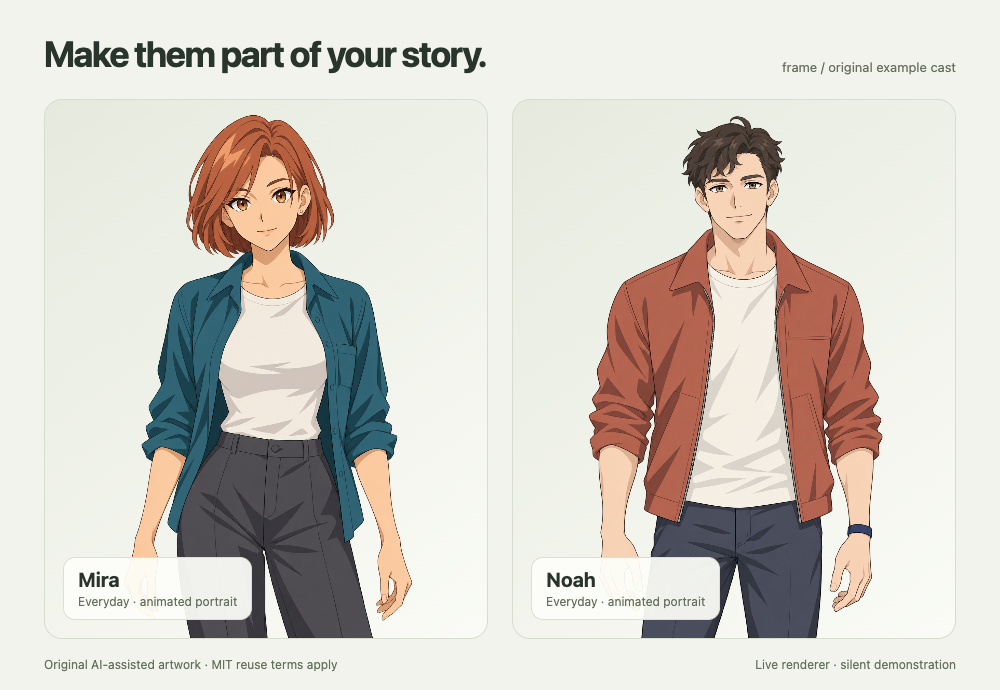

# The original example cast

Mira and Noah are original contemporary character designs supplied for learning, remixing, and testing Frame. Both have one approved everyday pose, six speaking mouth shapes plus exact rest, independent blinks, restrained gaze, source-pixel brow movement, and subtle head/body motion. They do not include a voice recording or a provider voice ID. Mira's hair-covered brow stays fixed. Separate articulated hair layers are not supplied.



Open **Animation lab** to compare mouth shapes, trigger a blink, and isolate motion controls. Use your own recording and aligned cues for lip sync. A silent story still blinks and breathes; it does not pretend that text alone is an audio performance.

## Sources and reproduction

Each character has an immutable approved portrait, raw edit generations, hash-based provenance, a mouth assembly specification, and a calibrated pose under `art/characters/`. Raw generations include rejected candidates; only the pose and assembly specifications determine what enters the runtime pack. `public/assets/characters/` contains the distributable packs used by the studio's First Light and Stage tour templates. The engine's minimal schema examples use small SVG portraits for applications that do not need the studio asset library.

```sh
npm ci
npm run setup:browser
node scripts/character/assemble-mouth.mjs art/characters/mira/edits/mouth-assembly.json --replace
node scripts/character/assemble-mouth.mjs art/characters/noah/edits/mouth-assembly.json --replace
npm run examples:build
```

These commands only register, crop, mask, color-match, warp, and pack supplied source pixels. They do not contact an image or speech provider. Rebuilding an existing pack retains a hidden recovery copy beside it; those copies are ignored and excluded from distribution. Normal `npm run build` uses the checked-in examples and needs no character-compilation browser.

The original portraits and facial edits were created with OpenAI's built-in image generator, with human design selection and manual calibration. No third-party character image was supplied as a reference. See each character's `provenance.json` for generation prompts, hashes, and design acceptance. Original assets are offered under MIT to the extent rights are held; AI-generated material may not be copyrightable everywhere. No exclusivity or franchise rights are claimed.

## Reviewing a rig

Inspect native pixels and enlarged faces, especially during partial eyelid closure. Mesh validity alone does not prove that donor artwork is registered: donor eye apertures must be measured independently from the approved open eyes. Boundary color matching should sample skin, not propagate white sclera or dark eyelashes onto closed lids. The supplied brows use deterministic source-pixel warps to keep the approved painting.

To reproduce the silent documentation demo and a self-contained rig playground, run `npx tsx scripts/capture-examples.ts`. The playground is written to `artifacts/rig-playground.html`; the 36 PNG frames can be assembled with FFmpeg at 12 fps. This uses the actual portrait controller and makes no provider requests.

The public examples' automated checks cover source hashes, asset closure, fold-free transitions, blink isolation/restoration, and offline playback. Visual checks cover intermediate closures, mouth shapes, brows, and natural-speed playback. A user's approval of the design and a technical rig review are separate records.
