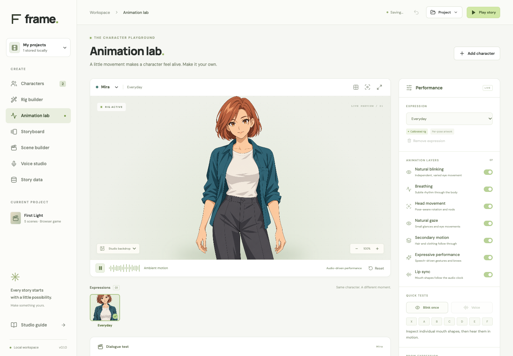
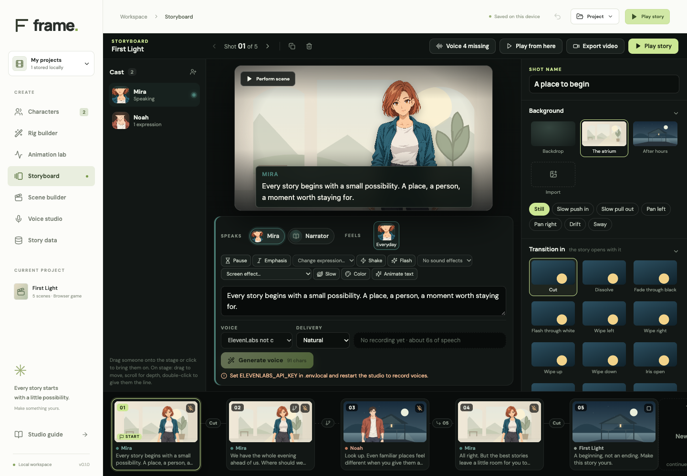
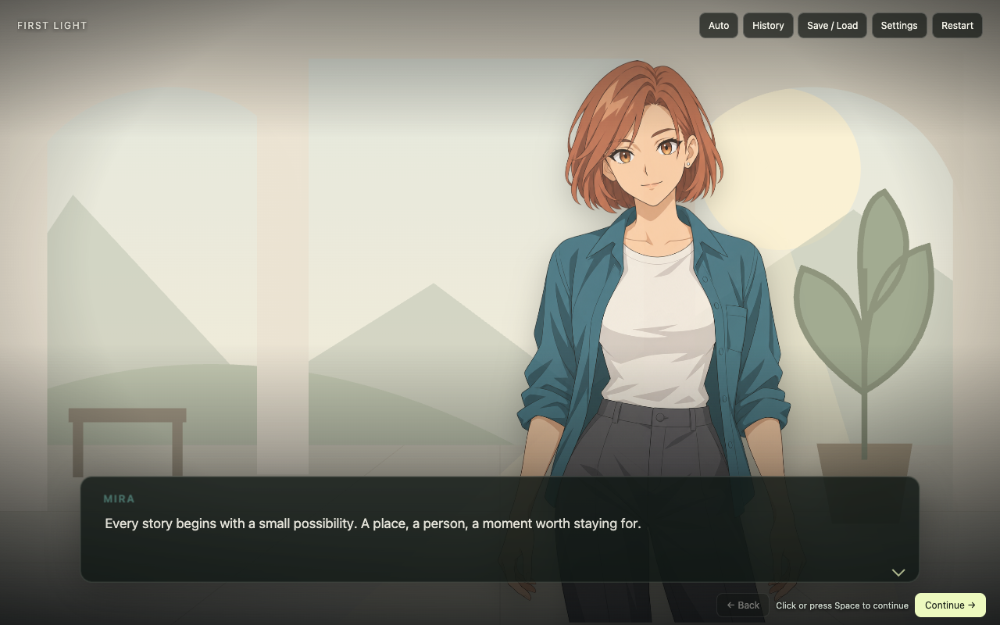

# Your first story in Frame

Frame runs on your computer. You can write, stage, play, and export a story without an account or API key. Optional generated speech and local MP4 rendering have additional requirements; start with an ordinary playable game.

[Watch the silent edit/play/export walkthrough](https://github.com/Marioarttv/frame-vn/releases/download/v0.1.0/studio-walkthrough.mp4), or follow the steps below.

## 1. Install and open the studio

Install Node.js **22.12 or newer**, then clone this repository and run:

```sh
git clone https://github.com/Marioarttv/frame-vn.git
cd frame-vn
npm ci
npm run dev
```

Open **http://127.0.0.1:5178**. Keep the terminal running while you work. Stop the server with **Ctrl+C** when you finish. If another project uses that port, run `FRAME_PORT=5186 npm run dev` and open **http://127.0.0.1:5186** instead (PowerShell: `$env:FRAME_PORT=5186; npm run dev`).

The opening project is **First Light**, a short conversation with two possible paths. **Animation lab** is the initial workspace. Use the sidebar to move between the studio's views.



## 2. Play the example

Open the project menu and choose **Play story**. Start the story, advance the conversation, and choose each branch. The same player powers the studio preview and exported game.

Click or press **Space**, **Enter**, or **→** to advance. **←** goes back; **H** opens history; **A** toggles auto advance. Use **Settings** to adjust text speed and the different audio channels. **Escape** closes the studio preview.

## 3. Make it yours

Use **Manage projects** to duplicate the example before changing it. Give your copy a title that describes your story. Changes save automatically in this browser on this device, including unfinished scenes.

Browser storage is not a backup. Changing browser profiles, clearing site data, or using a different port changes the storage context. Use **Project → Export project JSON** regularly. That export includes the project's images and recordings so you can keep or move the editable story.

## 4. Write and stage a conversation

Open **Storyboard**. Select a shot in the filmstrip and edit its dialogue. Choose who speaks and which expression they use. Drag a character from the cast dock onto the stage, then drag them to a stage position. Double-click a character to give them the line. Scroll over a character to adjust depth.

Use the inspector to choose the background, transition, camera, text box, and atmosphere. Add a new shot to continue the conversation. New shots continue the stage and hand the line to the character who was listening. **From previous shot** previews the cut into the selected shot.

For direct graph and logic editing, open **Scene builder**. Its inspector has **Write**, **Stage**, **Look**, and **Sound & voice** tabs. **Play from here** checks a scene in context without restarting the entire story.



## 5. Add a choice

In **Scene builder**, select the example's choice scene. Edit its options and their destination scenes. Each option points to the scene reached when the reader selects it. Use **Story map** to check the connections, then play both branches.

Variables, conditions, and effects let you make later dialogue depend on earlier choices. Start with an ordinary branch, then add conditions once both paths work. The [project-format guide](project-format.md) explains the data model and markup.

## 6. Bring your own media

Import portraits and expressions in **Characters**, then add backgrounds or audio through the relevant story controls. Use files you created or have permission to use and redistribute. A static portrait works as a portrait; convincing lip sync and blinking need a calibrated rig with authored facial artwork.

The **Rig builder** accepts a source portrait and expression-specific feature sheets. It packs and registers those inputs; it does not invent missing art. See [character authoring](character-authoring-api.md) before preparing a new cast.

For audio, begin with a short recording you own. Optional provider generation needs your own server-side key, FFmpeg/FFprobe, and a working Rhubarb installation. It may incur charges. See [voice setup](voice-pipeline.md); no paid generation is needed for this walkthrough.

## 7. Export a playable game

Choose **Project → Export playable game**. Frame packages the used story assets and player into one HTML file. Unused expressions and recordings are excluded; missing required files produce an error instead of a partial export.

Open the downloaded HTML directly in a browser, disconnect networking, and play every branch. Test history, restart, sound controls, and save/load before sharing. Browser audio may need a click on **Begin story** first.

The game includes the media used in your story. Share it only when those media permissions allow it. Frame's engine license does not grant rights to imported character art, music, or voices.



## 8. Keep an editable backup

Keep both the **project JSON** and the **playable HTML**. The JSON is your editable project backup; the HTML is the game you give readers. An MP4 is a recording of one selected route and cannot replace either. See [video export](video-export.md) when you want a trailer or a linear video version.

## Next steps

Create the **Stage tour** template from **Manage projects** to explore the presentation options. Read [troubleshooting](troubleshooting.md) if something behaves differently, or [Contributing](../CONTRIBUTING.md) if you want to improve Frame itself.
